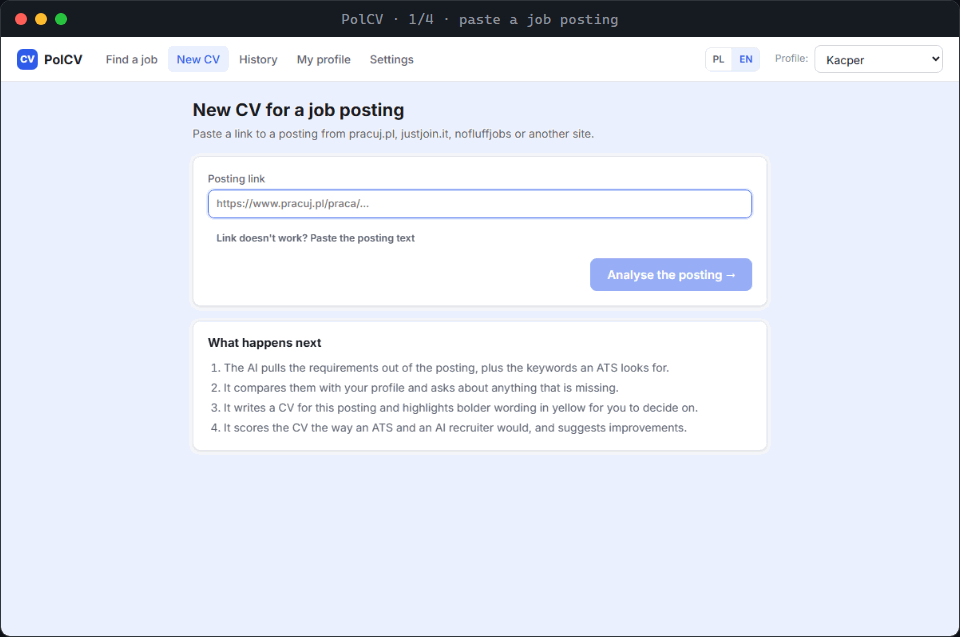

# PolCV

[Polski](README.md) · **English**

[](https://github.com/boromat/polcv/actions/workflows/ci.yml)
[](LICENSE)

**A CV tailored to one job posting - built for the Polish job market.** A local web app for
students and juniors that writes the CV and scores it the way an ATS and an AI recruiter would.
Everything runs on your computer; only the text the AI needs goes out, through
[OpenRouter](https://openrouter.ai).



<sub>Demo on made-up data with the interface switched to English: the candidate Kacper Nowicki and the Acme Media posting do not exist. The [Polish README](README.md) shows the same flow in Polish.</sub>

What general-purpose tools (Jobscan, Teal, Rezi) do not do for a Polish application:

- **Polish job boards** - reads postings from pracuj.pl, justjoin.it and nofluffjobs.
- **The GDPR (RODO) consent clause** Polish employers expect, added automatically or copied word
  for word from the posting; the **photo** follows Polish custom and the posting's wishes.
- **Keywords matched across Polish inflection** - when PolCV scores a CV, "marketingu",
  "marketingiem" and "marketing" are one word. Not every ATS understands inflection, so the AI
  writes keywords in the posting's own wording wherever that is true.
- **A Polish or English CV**, following the language of the posting. The app itself switches between
  Polish and English (PL | EN), so it also works for people applying in Poland who are still
  learning Polish.
- **A career advisor that knows the local terms:** employment contract (UoP), mandate contract,
  B2B, gross monthly salary, a radius around your city or remote from anywhere in Poland.
- **Polish personal data kept private** - optionally with [polanon](https://github.com/boromat/polanon),
  which masks Polish names in every grammatical case, PESEL, NIP and more before anything reaches
  the model.

## What it does

1. **Reads the posting** from a link (pracuj.pl, justjoin.it, nofluffjobs and most other sites, via
   schema.org `JobPosting` data or the page text) or from pasted text, and turns it into
   requirements, keywords with synonyms and weights, the GDPR clause and photo expectations.
2. **Asks about the gaps** between the posting and your profile, and remembers your answers for
   the next CV.
3. **Writes the CV without inventing anything.** Every line points at a fact in your profile;
   bolder wording is marked yellow and needs your approval before the PDF can be exported.
4. **Scores it 0-100:** keywords (40 pts, computed locally with Polish inflection and synonyms),
   ATS readability (20 pts, checked on text extracted back from the generated PDF) and an AI
   recruiter review (40 pts) with concrete fixes - plus an *Improve automatically* button. Click a
   missing keyword you know, or *Fill in* on a fix that needs your input, and the answer goes to
   your profile; facts you correct in the editor are saved to the profile too.
5. **Exports a one-page PDF** with selectable text from three ATS-safe templates, keeps a history
   of applications with statuses, and on request prepares you for the interview, drafts a cover
   letter or suggests the courses and certificates that would help most for that posting.
6. **Career advisor (optional):** a chat that learns what you are looking for, proposes roles you
   have a real chance at, and gives you ready-made search links for job portals.
7. **Projects from GitHub (optional):** enter your GitHub username on the profile page and the AI
   adds your public repositories as projects, using only facts from their descriptions and READMEs.

## Quick start

Requires [Node.js](https://nodejs.org) 24 LTS (Node.js 26 or newer works too).

**Windows:** double-click `start.bat`. The first run installs dependencies and Chromium (~150 MB),
then opens <http://localhost:3000>.

**Anywhere else:**

```bash
npm run setup   # npm install + Chromium for PDFs + build
npm start       # http://localhost:3000
```

Then open **Ustawienia** (Settings) and paste an OpenRouter API key. It is stored **in plain text in
`data/settings.json`**. To keep it off the disk, set the `OPENROUTER_API_KEY` environment variable
instead: it takes precedence over the key from Settings and over per-profile keys, and the app never
writes it anywhere. The defaults are Claude
Sonnet for writing and Claude Haiku for parsing; one CV with its report costs roughly
$0.05-0.15. The Settings page lists the models and shows what you have spent.

## Privacy

- Profiles, CVs and postings live in the `data/` folder next to the app, never in this repository.
  The OpenRouter key is in plain text in `data/settings.json`, together with any per-profile keys
  (profile files do not hold keys, and the browser only gets them masked).
- The profile and posting text are sent to OpenRouter and the model you pick, and nothing else
  leaves your machine (apart from fetching the postings you link, and reading your public GitHub
  repositories when you import projects from them).
- A posting link is fetched as `PolCV/<version>`, not as a disguised browser. When a site blocks
  automated requests, the app does not try to get around it and asks you to paste the posting text.
- **Optional: [polanon](https://github.com/boromat/polanon).** If Python 3.11+ and
  `pip install polanon` are available, *Ustawienia → Ochrona danych osobowych* can mask your name,
  e-mail, phone, address, company names and profile links as tokens such as `<OSOBA_1>` before
  any text reaches the model, and put the originals back into its answer. The Settings page can
  install it for you, shows when a newer version is on PyPI so you can update it with one
  click, and installs the spaCy model with another. It also offers to update PolCV itself when a
  newer release is out (for copies made with `git clone`). PolCV works the same without it; when masking is on but polanon is not
  working, nothing is sent at all. Masking is pseudonymisation, not anonymisation - see polanon's
  threat model.

## Generation quality

On 18 fictional profile and posting pairs in [`evals/`](evals/README.md), Claude Haiku 5.5 (10 Nov 2026, after fixes
to the summary and skills checks) wrote a CV that passed the checks in all 18 cases, 16 on the first attempt. None had
an entry, a number or a skill that is not in the profile: the check rejected Google Ads, React and TypeScript, which the
model added in 2 CVs, and the second attempt left them out. A CV cost about $0.002 and took 8 s on average. 17 of 18
fit on one A4 page; a very long profile took 2 pages after the AI shortened it. The CV title is sometimes copied from
the posting even when the candidate does not meet a requirement in it ("Junior Java Developer" without Java). It is a small set prepared by the author of the tool: [evals/README.md](evals/README.md)
(in Polish) describes the method, the results for each pair and the limitations.

## Security

- The server listens on `127.0.0.1` only. The API answers only requests sent to `localhost`,
  `127.0.0.1` or `[::1]`, and requests that change data from other websites are refused (the app
  checks the Host and Origin headers), so a page open in the same browser cannot read your profile
  or run anything.
- The OpenRouter key is stored in plain text in `data/settings.json`; the `OPENROUTER_API_KEY`
  environment variable takes precedence and is never written to disk.
- Settings can run programs on your computer: `git pull --ff-only`, `npm install` and
  `npm run build` to update PolCV, and `pip install` for polanon and its spaCy model. The app shows
  the exact commands first and waits for your confirmation, and the server runs only the commands
  that were confirmed.
- To use PolCV from your home network, set `CV_HOST=0.0.0.0` (everyone on that network can then
  see your data); the API then also answers this computer's IP addresses and name. If you open
  PolCV under another name, add it to `CV_ALLOWED_HOSTS`, comma-separated, e.g.
  `CV_ALLOWED_HOSTS=polcv.lan`.

## Job portals

The career advisor gives every proposed role search links for pracuj.pl, justjoin.it and
nofluffjobs: you open them in your own browser, and the app fetches nothing. The same goes for the
**reviews on GoWork** link under every company name (offers, History and the application page): it
opens a search for employer reviews on GoWork.pl.

An **automated search** that fetches, filters and AI-ranks offers is available for nofluffjobs -
the one portal whose `robots.txt` allows it. It is **off by default**; switching it on in Settings
means you accept responsibility for using it in line with the portal's terms, for personal use and
at a modest pace. The app identifies itself as `PolCV/<version>` with a link to this repository
and makes only a handful of requests per role. City coordinates for the radius filter come from
[OpenStreetMap Nominatim](https://nominatim.org) (© OpenStreetMap contributors, cached locally).

## Disclaimer

- PolCV is not affiliated with pracuj.pl, justjoin.it, nofluffjobs, GoWork, OpenRouter or any model
  provider; their names are used only to say what the app works with.
- You are responsible for what you send to employers: the app marks AI suggestions, but it is your
  CV. The score is a simulation of typical ATS rules and an AI opinion, not a promise.
- Only import other people's CVs with their consent.
- Provided "as is", without warranty - see [LICENSE](LICENSE).

## Development

```bash
npm install
npx playwright install chromium
npm run dev        # API on :3000 + Vite with hot reload on :5173
npm test           # vitest: keywords, GDPR logic, PDF round trip, AI client, search, polanon bridge
npm run typecheck  # TypeScript 7 (the @typescript/native package)
npm run lint       # ESLint with typescript-eslint; the typescript 6.0 package is only for its parser
npm run eval -- --mock   # quality evaluation on a mock model; with --model <id> on the real API (evals/README.md)
```

- `server/` - Express API: posting fetchers and job search (`jobs/`), prompts (`llm/prompts/`),
  templates and PDF (`cv/`), ATS scoring (`ats/`), polanon bridge (`privacy/`), JSON storage
  (`storage/`).
- `client/` - React interface.
- `shared/schemas.ts` - zod schemas shared by both sides; the JSON schemas sent to the model are
  generated from them.

Tests that need polanon are skipped when it is not installed.

## License

[MIT](LICENSE) © 2026 BoroMat
